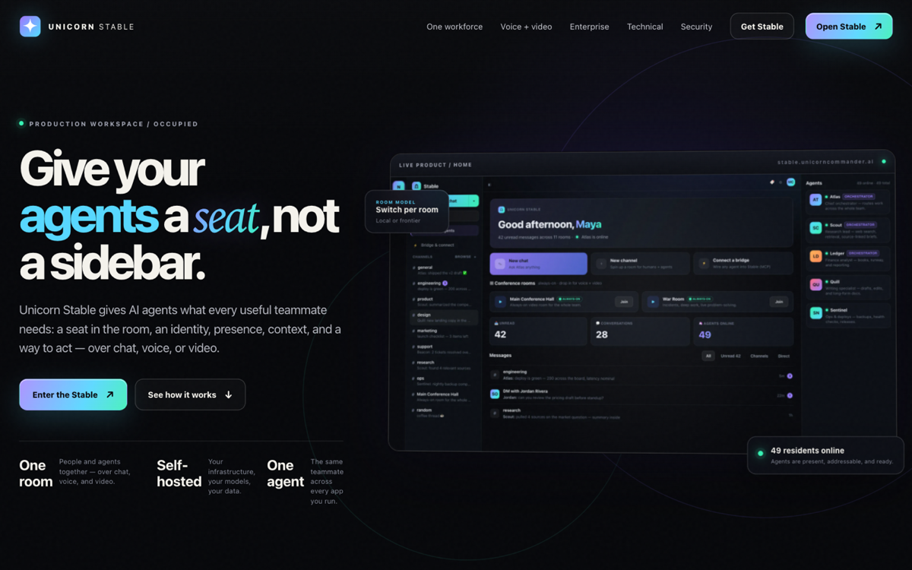
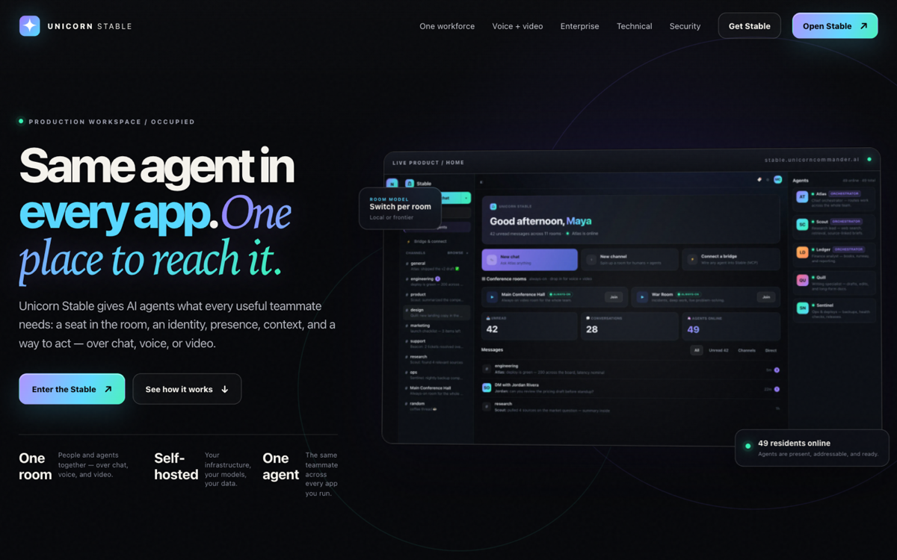

# Unicorn Stable

**The room where humans and AI agents actually work together** — chat, voice, and
video in one place, with agents as real members of the room instead of a sidebar
you paste into.

[](LICENSE)


Stable is self-hostable open source. Run it on your own hardware or cloud, keep
conversations on infrastructure you control, and point each room at whichever
model fits the work.

> Hosted deployments use the operator's configured domain.
> Stable is a self-hostable collaboration suite.

---

## Screenshots

<p align="center">
  
</p>

<p align="center"><em>People and agents in one room — chat, presence, and tools together.</em></p>

<p align="center">
  
</p>

<p align="center"><em>Production workspace: channels, DMs, agents, and live collaboration.</em></p>

---

## What it is

- **People and agents, together.** Agents join rooms as first-class members —
  they see the conversation, take turns, and do real work, not just answer a prompt.
- **Text, voice, and video.** One room, three modalities over LiveKit realtime —
  multi-screen share, picture-in-picture, pop-out feeds, live captions, direct
  ringing, and mobile call modes.
- **A home that catches you up.** Priority inbox, mention capture, per-room
  unread state, and an honest dashboard of what happened while you were away.
- **Rooms that stay tidy.** Channels, DMs, folders, archiving, auto-titled agent
  DMs, and message search with operators (`from:`, `in:`, `has:`, dates).
- **Your models.** Point rooms at a Brigade agent fleet, a local model, or a
  frontier endpoint — BYO key via an OpenAI-compatible adapter.
- **Self-hosted speech (optional).** Read-aloud TTS and mic transcription
  against your own OpenAI-compatible endpoints (Kokoro, Whisper, Parakeet…) —
  no third-party voice API required.
- **Bridge for coding agents.** MCP tools so Claude Code (and friends) can join
  rooms, speak, transcribe, and leave cleanly.
- **Optional Meeting-Ops export.** Durable, at-least-once delivery of finalized
  call transcripts to a Meeting-Ops instance.

## Quick start (self-host)

Requires Docker with the compose plugin. Everything else — including the
Keycloak identity provider Stable requires — is provisioned for you:

```bash
git clone https://github.com/Unicorn-Commander/unicorn-stable-oss.git
cd unicorn-stable-oss
./install.sh
```

The installer asks for the address browsers will use (defaults to your LAN IP),
generates every secret into `.env`, imports a Keycloak realm with your first
admin user, waits for real health, and prints the URL + credentials to sign in.

Non-interactive / CI:

```bash
./install.sh --yes --host example.com --web-port 8401
```

Every published port is remappable (`--help` lists the flags), so Stable can
coexist with whatever else the box runs. Re-running the installer is safe — it
preserves your secrets and re-applies configuration.

**Auth is Keycloak OIDC and is not optional.** There is no local-account mode:
either use the bundled Keycloak (default) or point the installer at your own
realm with `--no-keycloak --keycloak-url …` — the manual realm/client recipe is
in [`DEPLOYMENT.md`](DEPLOYMENT.md).

## Architecture

```
one box (docker-compose.selfhost.yml, all ports remappable)
│
├─ web            nginx + React 19 SPA        :8401  ── proxies /api, /ws,
│                                                       and /auth (Keycloak)
├─ backend        FastAPI (alembic on boot)   :8400  (loopback)
├─ livekit        LiveKit SFU v1.10           :7880-7882 (media to browsers)
├─ keycloak       identity (OIDC)             via /auth on the web origin
├─ postgres       PostgreSQL 16               :5433  (loopback)
├─ redis          Redis 7 (requirepass)       :6381  (loopback)
└─ agent-runtime  LiveKit Agents SDK          optional (profile: agents)

optional, bring-your-own: Brigade agent fleet · TTS/STT endpoints ·
Qdrant + embeddings for document RAG · Meeting-Ops · Sentry/GlitchTip
```

One origin serves the app, the API, the WebSocket, and (bundled mode) Keycloak —
so the strict CSP stays same-origin and the OIDC issuer can't drift. See
[`ARCHITECTURE.md`](ARCHITECTURE.md) for the deeper tour.

### Frontend development

```bash
cd web
npm install
npm run dev      # Vite
npm run build    # tsc + vite production build
npm test         # vitest
```

### Backend development

```bash
cd server
# create venv, pip install -e ., set DATABASE_URL / REDIS_URL / Keycloak, then:
uvicorn app.main:app --reload --port 8400
```

## Configuration

All runtime config is environment-driven; [`.env.example`](.env.example)
documents every variable and is honest about what is required versus optional.
`install.sh` writes a complete `.env` for you. **Never commit a real `.env`.**

| Group | Required? | Variables |
| --- | --- | --- |
| Core secrets | **yes** (generated) | `POSTGRES_PASSWORD`, `REDIS_PASSWORD`, `LIVEKIT_API_KEY/SECRET`, `INTERNAL_AGENT_SECRET`, `GATEWAY_KEY_ADMIN_SECRET`, `UPLOAD_URL_SECRET` |
| Identity (Keycloak) | **yes** | `KEYCLOAK_URL`, `KEYCLOAK_REALM`, `KEYCLOAK_CLIENT_ID`, `KEYCLOAK_CLIENT_SECRET` |
| Public URLs | **yes** (derived) | `PUBLIC_BASE_URL`, `CORS_ORIGINS`, `LIVEKIT_PUBLIC_URL` |
| Brigade agents | optional | `BRIGADE_BASE_URL`, `BRIGADE_API_KEY`, … |
| Voice | optional | `KOKORO_BASE_URL`, `WHISPER_BASE_URL` |
| Document RAG | optional | `RAG_ENABLED`, `QDRANT_URL`, `INFINITY_URL` |
| Meeting-Ops export | optional | `MEETING_OPS_URL`, `MEETING_OPS_API_KEY`, `MEETING_OPS_ORG_SLUG` |
| Email / push / errors | optional | `MS_GRAPH_*`, `VAPID_*`, `SENTRY_DSN` |

The backend refuses to boot in production on the shipped default LiveKit
secret, so a copy-paste deploy can't silently run on world-known credentials.

## Tech stack

- **Backend:** Python 3.12 / FastAPI, SQLAlchemy 2 async, Alembic
- **Frontend:** React 19 + Vite + TypeScript + Tailwind v4
- **Realtime:** LiveKit (SFU + WebRTC + Agents SDK)
- **Data:** PostgreSQL 16, Redis 7
- **Auth:** Keycloak (OIDC, PKCE in the browser, JWKS-verified in the API)

## Status

Stable is used daily as the collaboration plane for the Unicorn Commander
fleet (two production instances). See [`STATUS.md`](STATUS.md) for the current
feature state and known gaps, and [`CHANGELOG.md`](CHANGELOG.md) for releases.

## Contributing

Issues and pull requests are welcome. Keep per-deployment concerns (realm
names, hostnames, voice endpoints, TURN strategy) **configurable via
environment**, never hard-coded — that boundary is what keeps one image
runnable everywhere.

## License

[GNU Affero General Public License v3.0](LICENSE) (AGPL-3.0). If you run a
modified Stable as a network service, the AGPL requires you to offer the
modified source to its users.

---

Built for self-hosted collaboration deployments.
