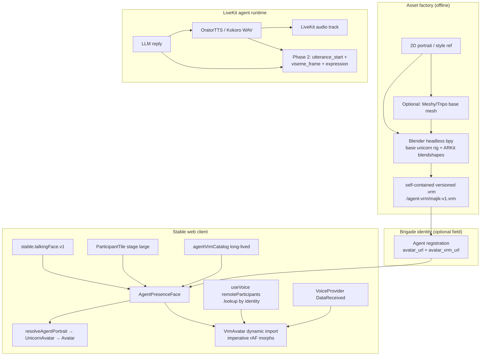
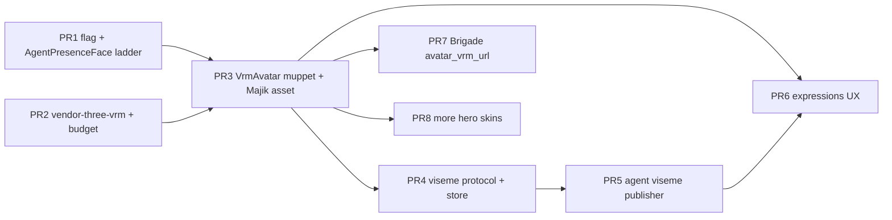

# Design: Talking-Face Hero Avatars (VRM + Visemes)

| Field | Value |
|-------|-------|
| **Document** | Talking-face hero avatars for Unicorn Stable |
| **Author** | Frontier Lane (design) |
| **Date** | 2026-07-31 |
| **Status** | Approved (revision 2 — design review consensus) |
| **Project-Ops** | P-00115 task f6402c49 ("Design: 3D talking unicorn avatars") |
| **Lane** | Frontier (cross-cutting: Stable client, Brigade identity, LiveKit agents, asset factory) |
| **Related** | Packets 01/02 avatar batch + Brigade avatar registration; handoff `05-talking-face-avatars-FRONTIER-LANE.md` |

---

## Overview

Basic agents are getting good static portraits (Brand-Ops → Brigade `avatar_url`). Hero agents that humans actually *talk to* in voice/video calls need faces that move: a 3D-ish unicorn head with lip motion and expressions, rendered cheaply on the client. This design specifies a VTuber-class path — one shared VRM rig, per-hero skins, three.js + `@pixiv/three-vrm` in the Stable web client, and a parallel viseme/expression stream on the existing LiveKit data channel — while deliberately avoiding neural talking-head APIs (server GPU per stream, latency, cost).

Phase 1 proves the entire path with **Majik only**: a rigged face on the **stage large tile** whose mouth tracks LiveKit `audioLevel` ("muppet mouth"), ≥30 fps on a mid-tier phone, zero server-side rendering, behind a feature flag. Later phases add phoneme-timed visemes from Kokoro TTS and an expression vocabulary aligned with Iris PNG states and `lk.agent.state`.

**Phase-1 DoD ownership:** merge of **PR1 + PR2 + PR3** (flag + ladder, vendor chunk, VrmAvatar + Majik asset). PR1 alone is not the DoD.

---

## Background & Motivation

### Current state (verified in codebase)

| Layer | What exists today |
|-------|-------------------|
| **Universal avatar primitive** | `web/src/components/ui/Avatar.tsx` — image → emoji → initials via `lib/avatar.ts` |
| **Procedural unicorn** | `web/src/components/Agents/UnicornAvatar.tsx` — animated SVG bust; comment states VRM pipeline replaces *this component* without changing *its* call sites |
| **Brand portraits** | `web/src/lib/brandAvatars.ts` + `web/public/agent-avatars/*` — static pack (Iris has `iris-thinking.png`, `iris-success.png`, `iris-alert.png`); **Majik and Sidekick deliberately absent** pending approved art |
| **Call tiles** | `VoiceVideoBar.tsx` → `ParticipantTile` renders `<Avatar avatarUrl={agent?.avatar_url} …>` when there is no camera track. Agents rarely publish video, so **this is the talking-face surface**. Large tiles use Avatar size **96**; normal/filmstrip/grid use **64** (`size === "large" ? 96 : 64`). `CallParticipant` has **no** `audioLevel` or LiveKit handle |
| **Audio-level driving** | `VoiceAgentStatus.tsx` rAF-samples `RemoteParticipant.audioLevel` (0..1) and calls `setLevel` each frame for a CSS orb — acceptable for one orb; **not** the pattern for three.js morphs (see Phase 1) |
| **Data channel** | `roomDataProtocol.ts` topic `"stable"`; families: `transcript`, `ui_command`, artifact events. Additive growth pattern already established |
| **TTS** | `agents/plugins/tts.py` — OratorTTS → Kokoro FastAPI (`POST /v1/audio/speech`, WAV 24 kHz); Majik → `af_heart`. No phoneme timing exposed yet |
| **Bundle** | `package.json` has `livekit-client`, **no three.js**. Budget gate in `web/scripts/check-bundle-budget.mjs` with exceptions for LiveKit/Mermaid |
| **Prefs / flags** | Priority pattern `localStorage` → `VITE_*` → default is in `navStore.isNavV1Enabled` (key `stable_nav_v1`, default **true** on that branch). Preference keys like `stable.theme.v1` are **not** feature gates. Talking-face uses the same *priority order* but **defaults off** |

### Handoff wording vs this design

The handoff and `UnicornAvatar` comment claim the VRM pipeline "replaces this component without changing any call site." That applies to **call sites of `UnicornAvatar`** (Home, ChatPanel typing indicator, etc.): they keep the same props if/when UnicornAvatar itself grows a richer renderer. **Call tiles today use bare `Avatar`**, not UnicornAvatar — so `ParticipantTile` **must** switch to a call-only composer (`AgentPresenceFace`) for ladder + VRM. That is intentional and required for bundle safety.

### Pain points

1. **Agents look dead in calls.** Stage tiles show a static circle (or initials) while Kokoro speech plays.
2. **Neural talking-head APIs are the wrong trade.** Server GPU per concurrent call, latency, cost.
3. **Call sites must not explode.** `Avatar` is universal; three.js must never land on chat chips or the initial bundle path.

### Why now

Portrait pipeline (packets 01/02) is landing; style refs exist. UnicornAvatar reserved the richer-renderer contract. VoiceAgentStatus proved LiveKit audio-level access without agent changes. Remaining work is composition, assets, and a thin data-channel extension.

---

## Goals & Non-Goals

### Goals

1. **Phase 1 DoD (PR1+PR2+PR3):** Dogfood call with Majik shows a rigged unicorn face on the **stage large tile**, mouth moves with speech, ≥30 fps on a mid-tier phone (verified procedure below), zero server rendering, feature-flagged. Demo clip to `#aaron-claude-code` and P-00115.
2. Client-side VRM via three.js + `@pixiv/three-vrm`, dynamic-imported only when flag on **and** hero has a VRM URL **and** tile is VRM-eligible (stage large / fill / pop-out large).
3. Fallback ladder that never leaves a blank tile: VRM → portrait → UnicornAvatar → initials.
4. Additive data-channel protocol for phase-2 visemes/expressions.
5. Coordinate with Brigade so VRM can become a registration artifact; **client catalog remains a long-lived fallback**, not dogfood-only.
6. Performance: imperative morph updates; concurrent VRM faces limited to stage-large surfaces; dispose on unmount (including pop-out).

### Non-Goals

- Neural / server-side talking-head video.
- VRM on filmstrip, grid-normal, chat chips, people drawer, settings (phase 1).
- Full facial performance capture or user VRM upload.
- Perfect phoneme accuracy in phase 1.
- Replacing human camera tiles or screen-share stage with VRM.
- Re-litigating the agreed architecture without new evidence.

---

## Proposed Design

### Architecture



### Call-site API: `AgentPresenceFace` (preferred)

**Decision: option (b)** — introduce `AgentPresenceFace` for **call stage surfaces only**. Do **not** extend `Avatar` with `vrmUrl` in phase 1.

Rationale:

- `Avatar` is a cheap universal primitive. WebGL must not touch chat chips/lists.
- `AgentPresenceFace` is the call-tile composer that selects VRM vs Unicorn vs static.
- **Filmstrip, grid-normal, and `AudioChip` stay on 2D** (`Avatar` / portrait / UnicornAvatar).

#### Fallback ladder (render order)

```
1. VRM face          — flag ON ∧ resolved vrmSrc ∧ allowVrm ∧ WebGL OK
2. Static portrait   — resolveAgentPortrait(...)
3. UnicornAvatar     — procedural SVG (talking when isSpeaking)
4. Avatar initials   — resolveAvatar last resort
```

#### Portrait resolve (one pure function)

Tiles today only pass `agent?.avatar_url` from `appStore.agents` and **never** call `brandAvatarFor`. `AgentPresenceFace` must unify:

```ts
// web/src/lib/resolveAgentPortrait.ts
import { toAvatarSrc } from "@/lib/avatar";
import { brandAvatarFor } from "@/lib/brandAvatars";

/** Portrait URL for the 2D ladder rung, or null → UnicornAvatar. */
export function resolveAgentPortrait(
  agentId: string | null | undefined,
  name: string | null | undefined,
  avatarUrl: string | null | undefined,
): string | null {
  const fromRoster = toAvatarSrc(avatarUrl);
  if (fromRoster) return fromRoster;
  // brandAvatarFor returns same-origin paths like /agent-avatars/iris.png
  return brandAvatarFor(name) ?? brandAvatarFor(agentId) ?? null;
}
```

Order: **safe roster/Brigade `avatar_url` → brand pack by name/id → null** (then UnicornAvatar).

#### WebGL eligibility gate (tile role, not pixel size)

Verified: large tiles use 96px Avatar, normal/filmstrip/grid use **64px**. Gating on `size >= 64` would mount WebGL on every normal agent tile — **forbidden**.

```ts
/**
 * VRM / WebGL only on stage-class surfaces.
 * - size === "large"  → spotlight/focus stage, pop-out buildTile({ size: "large" })
 * - fill === true     → stage fill layouts that still use normal size label in some paths
 * Never for filmstrip/grid normal tiles or AudioChip.
 */
export function isVrmSurfaceEligible(opts: {
  size?: "normal" | "large";
  fill?: boolean;
  inPopout?: boolean;
}): boolean {
  return opts.size === "large" || !!opts.fill || !!opts.inPopout;
}
```

Safety net: even if eligible, refuse WebGL when container CSS box &lt; 80px (broken layout). **Never** enable solely because Avatar pixel prop is 64.

#### Presence-face eligibility (agent identity — not Brigade roster alone)

Verified: `CallParticipant.isAgent` is set only when `matchAgent(identity)` hits `api.getBrigadeAgents()` (`VoiceVideoBar.tsx` ~890–941). If that query is empty/slow/failed, `agent-majik` has `isAgent: false` and would stay on bare `Avatar`.

For talking-face / presence-face mounting, use **identity rules**, not roster hit:

```ts
function isAgentIdentity(identity: string): boolean {
  return identity === "local"
    ? false
    : identity.startsWith("agent-") || /* optional: kind/metadata if participant handle present */;
}
```

Prefer `isAgentParticipant(remoteParticipant)` when a LiveKit handle is available; otherwise `identity.startsWith("agent-")`. Use `p.isAgent || isAgentIdentity(p.id)` for the swap. Resolve VRM catalog from the **stripped LiveKit slug** (`agent-majik` → `majik`) regardless of roster hit. Keep `appStore.agents` / Brigade only for portrait/emoji enrichment.

#### Proposed component interface

```ts
// web/src/components/Agents/AgentPresenceFace.tsx
export type PresenceExpression =
  | "idle"
  | "listening"
  | "thinking"
  | "speaking"
  | "pleased"
  | "alert"
  | "success"
  | "working"
  | "offline";

export type PresenceSurface = "stage" | "filmstrip" | "chip";

export interface AgentPresenceFaceProps {
  /** LiveKit identity or slug — prefer full identity "agent-majik" for level lookup. */
  participantId: string;
  /** Display / catalog slug without agent- when known. */
  id: string;
  name: string;
  /** Raw roster avatar URL; resolved via resolveAgentPortrait. */
  avatarUrl?: string | null;
  /** Optional Brigade/server VRM field; catalog fills if null. */
  vrmUrl?: string | null;
  emoji?: string | null;
  /** Pixel box for 2D fallbacks (96 stage large, 64 filmstrip). */
  size: number;
  /**
   * WebGL gate: only "stage" may load VrmAvatar.
   * ParticipantTile passes surface="stage" when isVrmSurfaceEligible(...).
   */
  surface: PresenceSurface;
  expression?: PresenceExpression;
  /** Boolean speaking only — NOT a per-frame level prop. */
  isSpeaking?: boolean;
  className?: string;
  alt?: string;
}
```

#### `ParticipantTile` swap

```tsx
const agentIdentity = isAgentIdentity(p.id) || p.isAgent;
const allowVrm = isVrmSurfaceEligible({ size, fill, inPopout });

// Agent tiles (including when Brigade roster miss):
agentIdentity ? (
  <AgentPresenceFace
    participantId={p.id}                 // "agent-majik"
    id={p.id.replace(/^agent-/, "")}
    name={p.name}
    avatarUrl={agent?.avatar_url}
    vrmUrl={agent?.avatar_vrm_url /* if present */}
    emoji={agent?.emoji}
    size={size === "large" ? 96 : 64}
    surface={allowVrm ? "stage" : "filmstrip"}
    expression={mapAgentState(agentState)}
    isSpeaking={speaking && !p.isMuted}
  />
) : (
  <Avatar /* humans unchanged */ />
)
```

Compact `AudioChip` stays on `Avatar` (`surface` never stage).

### Feature flag

Priority order mirrors `isNavV1Enabled` (localStorage → env → default), but talking-face **defaults OFF** (nav-v1 on this branch defaults on — do not copy that default).

```ts
// web/src/lib/talkingFaceFlag.ts
export const TALKING_FACE_FLAG_KEY = "stable.talkingFace.v1";

/** Priority: localStorage → VITE_TALKING_FACE_V1 → default false. */
export function isTalkingFaceEnabled(): boolean {
  if (typeof window !== "undefined") {
    try {
      const raw = localStorage.getItem(TALKING_FACE_FLAG_KEY);
      if (raw === "0" || raw === "false") return false;
      if (raw === "1" || raw === "true") return true;
    } catch { /* private mode */ }
  }
  const env = import.meta.env.VITE_TALKING_FACE_V1;
  if (env === "1" || env === "true") return true;
  return false;
}
```

Dogfood: `localStorage.setItem("stable.talkingFace.v1", "1")` then reload.

### Phase 1 — Muppet mouth (no agent code changes)

#### How `ParticipantTile` obtains audio level (locked)

`CallParticipant` does **not** grow an `audioLevel` field and does **not** pass smoothed level as a React prop.

1. `ParticipantTile` / `AgentPresenceFace` pass **`participantId`** (`p.id`, e.g. `agent-majik`) into `VrmAvatar` only when `surface === "stage"` and VRM will mount.
2. **`VrmAvatar` owns the LiveKit lookup and the rAF loop**:

```ts
// Inside VrmAvatar (imperative — NOT setState per frame)
const { remoteParticipants, room } = useVoice();
const participantRef = useRef<RemoteParticipant | null>(null);

useEffect(() => {
  participantRef.current =
    remoteParticipants.find((p) => p.identity === participantId) ?? null;
}, [remoteParticipants, participantId, /* voice version */]);

// In the three.js render loop (same rAF that calls renderer.render):
const raw = participantRef.current?.audioLevel ?? 0;
levelSmoothed += (raw - levelSmoothed) * 0.25;
vrm.expressionManager?.setValue("jawOpen", levelSmoothed);
// or humanoid jaw bone / alias map — see Spike asset contract
```

3. Optional shared helper `getRemoteParticipant(identity)` (module or thin hook returning a **ref**, not a number state) may be reused by `VoiceAgentStatus` later; phase 1 may keep VoiceAgentStatus as-is to limit scope.
4. Debug HUD may throttle React state to ~10 Hz when `stable.talkingFace.debug` is on — never drive morphs from that state.

**PR1–3 require zero agent runtime changes.**

### VRM asset for spike — Spike asset contract

| Path | When | Quality bar |
|------|------|-------------|
| **A. Crafted VRM** | Preferred when Blender base rig is ready | Base unicorn head; ARKit blendshapes; Majik skin from `majik-v4.png`; ≤4 MB self-contained; `/agent-vrm/majik-v1.vrm` |
| **B. Interim minimal VRM** | **Default for PR3 if A not ready** | Hand-authored glTF/VRM with unicorn bust + **required** mouth morph; on-brand; `majik-spike-v0.vrm` |
| **C. Procedural three.js head** | Last resort | Same morph API (`setMouthOpen(0..1)`); no `.vrm` file |

#### Spike asset contract (path B)

| Item | Requirement |
|------|-------------|
| **Owner** | Frontier implementer of PR3 (engineer with Blender and/or gltf-transform). Brand-Ops signs off only when promoting A over B |
| **Required morph** | Primary name `jawOpen` (ARKit). Alias map in code: `jawOpen` → `A` → `mouthOpen` → first morph containing `jaw`/`mouth` |
| **Optional** | blink L/R, ear bone — nice-to-have for spike |
| **Self-contained** | Single `.vrm`/`.glb` with embedded buffers+images; **no** external URI references |
| **Max size** | ≤ 6 MB raw on disk (prefer ≤ 4 MB); CI soft gate or PR checklist |
| **Binary policy** | Commit under `web/public/agent-vrm/` in git (versioned name). LFS only if repo policy already requires it for binaries &gt; threshold — otherwise plain git for ≤6 MB spike is fine |
| **Content-Type** | Static host must serve `model/gltf-binary` or `application/octet-stream`; Cache-Control long-lived for versioned filenames (`immutable`) |
| **Acceptance** | Mouth visibly opens/closes with speech on dogfood; fallback ladder if load fails |

Style refs: `Documents/Agent-Handoffs-2026-07-31/avatar-style-refs/` (`majik-v4.png`, …).

### Phase 2 — Viseme accuracy (data channel)

#### Wire contract (additive)

Topic: `ROOM_DATA_TOPIC = "stable"`.

```ts
export type VisemeId =
  | "sil" | "PP" | "FF" | "TH" | "DD" | "kk" | "CH" | "SS"
  | "nn" | "RR" | "aa" | "E" | "ih" | "oh" | "ou";

/** REQUIRED control frame: starts the utterance clock on every client. */
export interface VisemeUtteranceStartMessage {
  type: "viseme_utterance_start";
  participantId: string;       // "agent-majik"
  utteranceId: string;         // uuid; new id cancels previous schedule
  /** Optional estimated duration ms for UI. */
  durationMs?: number;
  /** Agent-side t0 reference; clients use receive time + small lead, not wall sync. */
  ts: number;
}

export interface VisemeFrameMessage {
  type: "viseme_frame";
  participantId: string;
  /** ms from utterance start (audio clock). */
  t: number;
  viseme: VisemeId;
  w?: number;                  // 0..1 default 1
  utteranceId: string;
}

export interface ExpressionMessage {
  type: "expression";
  participantId: string;
  expression: PresenceExpression;
  ts: number;
  holdMs?: number;
  utteranceId?: string;
}

export type RoomDataMessage =
  | TranscriptMessage
  | UiCommandMessage
  | ArtifactEventMessage
  | VisemeUtteranceStartMessage
  | VisemeFrameMessage
  | ExpressionMessage;
```

#### Clock alignment (locked — utterance start required)

| Rule | Behavior |
|------|----------|
| **Required start** | Agent **must** publish `viseme_utterance_start` (reliable) before or with the first frame of an utterance. Frames without a known `utteranceId` start are **dropped**. A first frame with `t === 0` alone is **not** sufficient (ambiguous with late join). |
| **Client t0** | On receiving start for `utteranceId`, set `t0 = performance.now()` (+ optional 30–50 ms lead). Apply frames when `localElapsed ≈ t`. |
| **Late join** | Ignore frames until the **next** `viseme_utterance_start`. Fall back to audioLevel muppet mouth until then. |
| **Cancel / barge-in** | New `utteranceId` drops the previous schedule immediately. |
| **Queue depth** | Cap pending frames per participant (e.g. 64); drop oldest or all with `t < localElapsed - 100ms`. |
| **Not wall clock / LiveKit NTP** | Phase 2; revisit only if multi-viewer desync remains after required start. |
| **Reliability** | `viseme_utterance_start` + `expression`: **reliable**. `viseme_frame`: **unreliable** OK. |
| **Fallback** | No active utterance schedule → continuous audioLevel muppet mouth (phase-1 path). |

#### Publish rate / data-channel budget

Topic `stable` is shared with transcript, ui_command, artifacts.

- Publish visemes on **edges** (viseme id change) plus a **hold keyframe every 100 ms** while the same viseme is held — not raw audio-frame rates.
- Cap **≤ 20 messages/s/agent** for `viseme_frame`.
- Coalesce: if multiple frames queue in one agent tick, send latest + any edge transitions.
- Drop policy on client: `t < localElapsed - 100ms` discarded.

#### Kokoro / Orator timing feed

Today full WAV, no phoneme timeline. Phase-2 options:

1. Kokoro timestamps if midboy2 can expose them.
2. CPU aligner / grapheme→viseme schedule from WAV duration + text.
3. Proportional heuristic schedule.

Publish pattern mirrors `TranscriptPublisher` (`topic="stable"`). Emit `viseme_utterance_start` when TTS audio begins pushing to LiveKit.

⚠️ **Dogfood:** `stable-agents` bind-mounts `agents/` — **commit before rebuild** for phase-2 agent changes.

#### Client consumption

```ts
if (
  msg.type === "viseme_utterance_start" ||
  msg.type === "viseme_frame" ||
  msg.type === "expression"
) {
  if (!isAgentParticipant(participant)) return;
  useTalkingFaceStore.getState().ingest(msg);
  return;
}
```

Store holds per-`participantId` schedule; `VrmAvatar` reads **imperatively** each frame (or subscribes to utteranceId changes only — not every viseme via React).

### Phase 3 — Expressions + hero roster

| Expression | Source |
|------------|--------|
| `listening` | `lk.agent.state === "listening"` |
| `thinking` | `lk.agent.state === "thinking"` |
| `speaking` | `lk.agent.state === "speaking"` or audioLevel &gt; ε |
| `pleased` / `success` | LLM/tool metadata (Iris success) |
| `alert` | error / attention (Iris alert) |
| `idle` / `working` / `offline` | defaults / UnicornAvatar parity |

**Hero order:** Majik → Sidekick → Corporal Qwen → Iris. Skins may ship via **client catalog without Brigade** (PR8 does not block on PR7).

### `VrmAvatar` implementation sketch

```tsx
// Lazy only when: flag ∧ vrmSrc ∧ surface === "stage"
const VrmAvatar = lazy(() => import("@/components/Agents/VrmAvatar"));

// VrmAvatar.tsx responsibilities:
// 1. resolveVrmSrc(url) — NEVER toAvatarSrc
// 2. Fetch with AbortController + max bytes (6 MB); LoadingManager URL modifier
//    rejects non-allowlisted absolute URLs for external glTF resources
// 3. GLTFLoader + VRMLoaderPlugin; prefer self-contained files
// 4. Single WebGLRenderer; pixel ratio min(dpr, 1.5)
// 5. rAF render loop: sample audioLevel + viseme schedule → set morphs imperatively
// 6. dispose on unmount + window pagehide (pop-out documents)
// 7. IntersectionObserver + document.visibilityState to pause loop
```

#### Pop-out / PiP (phase 1 choice — locked)

**Allow VRM in pop-out** when `buildTile(..., { size: "large", inPopout: true })` (verified pop-out path uses large). Dispose:

- React unmount of the tile in the pop-out Host (primary).
- `window` `pagehide` / `beforeunload` on the detached document as belt-and-suspenders.
- Exactly-one-place invariant already prevents dual WebGL for the same feed.

### VRM URL resolution (not portrait helpers)

**Critical:** `toAvatarSrc` rewrites `/…` to `` `${avatarApiBase()}${raw}` `` — the **API** origin (e.g. `:8400`), not the Vite static origin that serves `web/public/`. Using it for VRM would 404.

```ts
// web/src/lib/resolveVrmSrc.ts
const VRM_HOST_SUFFIXES = [
  "magicunicorn.dev",
  "magicunicorn.tech",
  "unicorncommander.ai",
];

/** Resolve a VRM URL for fetch/loader. Relative → web origin (BASE_URL). */
export function resolveVrmSrc(url: string | null | undefined): string | null {
  if (!url) return null;
  const raw = url.trim();
  if (!raw || raw.startsWith("//")) return null;
  if (raw.startsWith("/")) {
    const base = import.meta.env.BASE_URL || "/";
    // same-origin static: /agent-vrm/majik-v1.vrm under web/public
    return `${base.replace(/\/$/, "")}${raw}`.replace(/\/{2,}/g, "/") || raw;
    // equivalently: new URL(raw, window.location.origin).href when in browser
  }
  let parsed: URL;
  try {
    parsed = new URL(raw);
  } catch {
    return null;
  }
  if (parsed.protocol !== "https:") return null;
  const host = parsed.hostname.toLowerCase();
  const ok = VRM_HOST_SUFFIXES.some(
    (s) => host === s || host.endsWith("." + s),
  );
  return ok ? parsed.href : null;
}

export const MAX_VRM_BYTES = 6 * 1024 * 1024;
```

#### Catalog keying

Prefer **stripped LiveKit identity slug**; normalize names like `brandAvatarFor`:

```ts
// web/src/lib/agentVrmCatalog.ts
const PACK: Record<string, string> = {
  majik: "/agent-vrm/majik-spike-v0.vrm", // promote to majik-v1 when craft lands
};

function catalogKey(agentId?: string | null, name?: string | null): string {
  const fromId = (agentId ?? "")
    .toLowerCase()
    .replace(/^agent[-_\s]+/, "")
    .trim();
  if (fromId && PACK[fromId]) return fromId;
  const fromName = (name ?? "")
    .toLowerCase()
    .replace(/^chat with\s+/i, "")
    .replace(/[_-]+/g, " ")
    .trim();
  // single token preferred
  const token = fromName.split(/\s+/)[0] ?? "";
  return token;
}

export function resolveAgentVrmUrl(
  agentId?: string | null,
  name?: string | null,
  serverVrmUrl?: string | null,
): string | null {
  if (!isTalkingFaceEnabled()) return null;
  if (serverVrmUrl) return resolveVrmSrc(serverVrmUrl);
  const key = catalogKey(agentId, name);
  const path = PACK[key] ?? PACK[catalogKey(null, name)];
  return path ? resolveVrmSrc(path) : null;
}
```

**Client catalog is long-lived** — Brigade `avatar_vrm_url` wins when present; catalog always backs dogfood and lag.

### Performance budget

| Constraint | Target |
|------------|--------|
| Frame rate | ≥30 fps avg over 15s while Majik speaks (see verification) |
| Concurrent VRM | **1** phase 1 (one stage large / pop-out); never filmstrip/grid-normal |
| Morph updates | Imperative in rAF; no React setState per frame |
| WebGL | Dispose on unmount + pop-out pagehide |
| Pixel ratio | `Math.min(devicePixelRatio, 1.5)` |
| Asset | Self-contained ≤6 MB; prefer ≤4 MB |
| Lazy load | Only flag ∧ vrmSrc ∧ `surface === "stage"` |
| Initial bundle | three / three-vrm absent from entry graph |

#### Phase-1 phone FPS verification (PR3 acceptance)

1. Enable flag + `localStorage.setItem("stable.talkingFace.debug", "1")` (debug HUD: rolling avg fps).
2. Join dogfood call with Majik; pin/spotlight so stage large VRM mounts.
3. While Majik speaks ≥15s, record **avg fps** from HUD.
4. Devices (minimum): one **iOS Safari** mid-tier (e.g. iPhone 12/13/SE 3rd) and one **Android Chrome** mid-tier (e.g. Pixel 6a / mid Samsung).
5. Pass: avg ≥30 fps on both; attach numbers + demo clip to P-00115 and `#aaron-claude-code`.
6. No automated perf CI in phase 1.

### Bundle strategy

1. Add `three`, `@pixiv/three-vrm`.
2. Dynamic import only from stage-eligible `AgentPresenceFace`.
3. Vite `manualChunks` — match carefully so unrelated packages are not scooped:

```js
// Prefer package path anchors
if (
  id.includes("/node_modules/three/") ||
  id.includes("/node_modules/@pixiv/three-vrm")
) {
  return "vendor-three-vrm";
}
```

4. Budget exception: **set numbers from first measured chunk** (+10–20% headroom), not a pre-seeded 1500/450 if lower. PR2 acceptance:

   - Paste full `check-bundle-budget` / build summary in PR body.
   - Confirm **entry gzip still ≤ 200 KiB**.
   - Confirm `vendor-three-vrm` is a separate chunk and **not** in the initial graph (unless someone incorrectly static-imported).
   - Set exception raw/gzip from measured sizes.

### Agent identification summary

| Signal | Use |
|--------|-----|
| `identity.startsWith("agent-")` | Presence-face eligibility even if Brigade miss |
| `isAgentParticipant(p)` | Data-channel gates + when LiveKit handle available |
| `CallParticipant.isAgent` (Brigade match) | Enrichment only; **not** sole gate for VRM |
| Catalog slug | `agent-majik` → `majik` |

### Security & privacy

- Top-level VRM URL: `resolveVrmSrc` allowlist (same host suffixes as avatars). Prefer same-origin `/agent-vrm/*`.
- **In-file glTF external resources:** Prefer self-contained VRM (offline-normalize Meshy/Tripo output). Loader uses a custom `LoadingManager.setURLModifier` / handler that **rejects** absolute URLs not on the allowlist and rejects `//` / non-https. Relative resource URLs resolve only under the VRM’s base path on our origin.
- **Fetch size:** `AbortController` + read stream with running byte count; abort if &gt; `MAX_VRM_BYTES` (6 MB); fall through ladder.
- Timeout: e.g. 15s load abort → fallback.
- Viseme/expression/utterance_start only from `isAgentParticipant(sender)`.
- No third-party mesh hotlink at runtime.

### Observability

| Signal | How |
|--------|-----|
| Flag | Log once per session when enabled |
| Load fail | warn + ladder; optional Sentry breadcrumb |
| FPS | Debug HUD behind `stable.talkingFace.debug`; PR3 records numbers |
| Viseme lag | Phase 2 debug histogram `localElapsed - t` |
| TTS metering | Unchanged (`tts.py`) |

### Risks

| Risk | Severity | Mitigation |
|------|----------|------------|
| three.js too heavy | High | Dynamic import; stage-only; pixel ratio; dispose; flag off |
| Crafted VRM late | Medium | Spike contract path B; owner = PR3 engineer |
| Bundle CI | Medium | Measured exceptions; package-path manualChunks |
| React thrash from levels | High if ignored | Imperative morphs only (KD 14) |
| Filmstrip WebGL thrash | High if size≥64 | Surface gate (KD 13) |
| Brigade roster miss | Medium | Identity-prefix eligibility (KD 16) |
| Viseme desync | Medium | Required utterance_start (KD 15) |
| glTF phone-home | Medium | Self-contained + URL modifier |
| Brigade schema lag | Low | Long-lived client catalog; PR8 independent |
| Agent bind-mount | Medium | Commit-before-rebuild phase 2 |

---

## API / Interface Changes

### Client (phase 1 = PR1–3)

| Surface | Change |
|---------|--------|
| `AgentPresenceFace` | **New** composer |
| `VrmAvatar` | **New** lazy three-vrm renderer (PR3) |
| `talkingFaceFlag.ts` | **New** |
| `agentVrmCatalog.ts` + `resolveVrmSrc.ts` + `resolveAgentPortrait.ts` | **New** |
| `ParticipantTile` | Stage-eligible agent path → `AgentPresenceFace`; identity-based agent detect |
| `AudioChip` / filmstrip | Unchanged 2D |
| `package.json` / vite / budget | three-vrm vendor (PR2) |
| `public/agent-vrm/` | Majik spike/craft asset |

### Client (phase 2)

| Surface | Change |
|---------|--------|
| `roomDataProtocol.ts` | `viseme_utterance_start`, `viseme_frame`, `expression` |
| `VoiceProvider.tsx` | Route + agent gate |
| `talkingFaceStore.ts` | Schedules per participant |
| `VrmAvatar` | Prefer schedule; else audioLevel |

### Agent runtime (phase 2)

| Surface | Change |
|---------|--------|
| `viseme_publisher.py` (+ tts hooks) | start + edge-limited frames on `stable` |

### Brigade / Stable (PR7, non-blocking for skins)

| Surface | Change |
|---------|--------|
| Brigade `avatar_vrm_url` | Optional |
| Stable brigade proxy + `Agent` type | Pass-through allowlisted |
| Client catalog | Remains fallback forever |

---

## Data Model Changes

### Phase 1

None on server. Static `web/public/agent-vrm/*`.

### Phase 2–3 (Brigade-owned, optional)

```text
agents (Brigade)
  + avatar_vrm_url  TEXT NULL
```

Stable degrades when null; catalog still serves heroes.

---

## Alternatives Considered

### 1. Neural talking-head API (server GPU stream)

**Verdict:** Rejected — cost, latency, ops; contradicts agreed architecture.

### 2. Extend `Avatar` with optional `vrmUrl`

**Verdict:** Rejected for phase 1 — bundle and complexity bleed into every consumer.

### 3. CSS/SVG-only mouth on brand portraits

**Verdict:** UnicornAvatar covers cheap tier; not the hero 3D path.

### 4. Ready Player Me / commercial VRM marketplace

**Verdict:** Rejected — off-brand, licensing, third-party hosts.

### 5. Client canvas composited as LiveKit video track

**Idea:** Render VRM (or mouth) to canvas; publish as agent camera track so tiles use existing `<video>` attach path (and PiP).

**Pros:** Reuses video tile plumbing; remote viewers could see the same pixels without each loading three.js.  
**Cons:** Capture/encode CPU on the publishing side (or on every client if each publishes locally only); complicates exactly-one-place track attach/PiP; still need WebGL somewhere; multi-viewer still prefers local VRM for zero encode cost. Publishing from the agent worker reintroduces server-side render cost.  
**Verdict:** Rejected for hero path. Local three.js in the tile is simpler and matches “zero server-side rendering.”

### 6. 2D Lottie / Spine mouth overlay on portrait

**Idea:** Lighter hero interim than full VRM.

**Pros:** Smaller than three.js; can look polished.  
**Cons:** Forks long-term rig path (no shared ARKit blendshapes/viseme map); another runtime dependency; does not deliver the agreed VRM craft pipeline.  
**Verdict:** Deferred/rejected as a parallel stack. UnicornAvatar already covers non-VRM motion; spike VRM (path B) is the interim on the **same** interface as craft VRM.

---

## Security & Privacy Considerations

Covered under Proposed Design (allowlist, self-contained glTF, size abort, agent-only data, dispose). Summary threats:

| Threat | Mitigation |
|--------|------------|
| Hostile VRM host | `resolveVrmSrc` allowlist; prefer same-origin |
| glTF external URI phone-home | Self-contained assets + LoadingManager URL modifier |
| Oversized asset OOM | MAX_VRM_BYTES + AbortController |
| Spoofed visemes | `isAgentParticipant` gate |
| WebGL fingerprinting | Flag off; construct only stage heroes |

---

## Observability

See tables above. Phase-1 minimum: flag log, load fail → fallback, **FPS procedure on two phone browsers**, demo clip.

---

## Rollout Plan

**Canonical plan = 8 PRs below.** Phase grouping for communication only:

| Phase | PRs | Notes |
|-------|-----|-------|
| **Phase 1 DoD** | PR1 + PR2 + PR3 | Client-only; flag default off; demo after PR3 on dogfood |
| **Phase 2 lips** | PR4 + PR5 | Protocol then agent publisher; commit agents/ before rebuild |
| **Phase 3 polish** | PR6 + PR7 + PR8 | Expressions; Brigade field (cross-repo); more skins (catalog OK without Brigade) |



Notes:

- **Phase-1 DoD = PR1+PR2+PR3 merged**, not PR1 alone.
- PR2 may land before PR1 if isolated, but three must not enter the entry graph until a lazy import exists (PR3). Preferred order: PR1 → PR2 → PR3.
- Rollback: flag `0` or remove catalog entry; no DB reverse for phase 1.

---

## Open Questions

1. **Shared vs per-tile WebGL** for multi-hero stage (phase 3) — start one instance; revisit if two large tiles needed.
2. **Exact Kokoro timing API** on midboy2 — timestamps vs aligner.
3. **Brigade field naming** — `avatarVrmUrl` vs `avatar_vrm_url` with packet 02.
4. ~~PiP/pop-out VRM~~ — **resolved:** allow with dispose (see Pop-out section).
5. **Craft signoff for retiring spike** — Aaron / Brand-Ops when path A lands (path B default for PR3).

---

## References

- Handoff: `Documents/Agent-Handoffs-2026-07-31/05-talking-face-avatars-FRONTIER-LANE.md`
- Avatar batch: `01-avatar-batch-FLASH-LANE.md`
- Brigade registration: `02-brigade-avatar-integration-LARGE-LANE.md`
- Style refs: `Documents/Agent-Handoffs-2026-07-31/avatar-style-refs/`
- Client: `web/src/components/ui/Avatar.tsx`, `Agents/UnicornAvatar.tsx`, `lib/avatar.ts` (`toAvatarSrc` / API base), `lib/brandAvatars.ts`
- Call surface: `web/src/components/Room/VoiceVideoBar.tsx` (`CallParticipant`, `ParticipantTile`, `AudioChip`, `buildTile` pop-out large)
- Audio-level precedent: `web/src/components/Room/VoiceAgentStatus.tsx` (orb only; not morph pattern)
- Data channel: `web/src/lib/roomDataProtocol.ts`, `web/src/contexts/VoiceProvider.tsx`
- TTS: `agents/plugins/tts.py`; `agents/agent_runtime/transcript_publisher.py`
- Bundle: `web/scripts/check-bundle-budget.mjs`, `web/vite.config.ts`
- Flag priority pattern: `web/src/stores/navStore.ts` (`stable_nav_v1` — different default)
- three-vrm: https://github.com/pixiv/three-vrm

---

## Key Decisions

| # | Decision | Rationale |
|---|----------|-----------|
| 1 | **Client-side VRM (three.js + three-vrm), not neural talking-head APIs** | Zero server GPU per stream; CDN assets; VTuber-class |
| 2 | **`AgentPresenceFace` for call stage only; leave `Avatar` cheap** | Bundle safety; intentional `ParticipantTile` swap (tiles used bare Avatar) |
| 3 | **Phase 1 muppet mouth from LiveKit `audioLevel` — no agent changes** | Unblocks DoD without bind-mount rebuild |
| 4 | **Flag `stable.talkingFace.v1` default OFF** | Same priority order as nav-v1; opposite default (safe dogfood opt-in) |
| 5 | **Spike VRM path B default if craft late; same morph API as A/C** | DoD not blocked on Meshy/Blender craft |
| 6 | **Dynamic import + package-path vendor chunk + measured budget exception** | Protect initial JS; PR2 records sizes |
| 7 | **Max concurrent VRM = stage large only (1 for Majik)** | Mobile WebGL; filmstrip stays 2D |
| 8 | **Additive face messages on topic `stable`** | Existing wire evolution pattern |
| 9 | **Utterance-relative viseme `t` + required `viseme_utterance_start`** | Multi-viewer clock without NTP |
| 10 | **`resolveVrmSrc` separate from `toAvatarSrc`** | Relative VRM is web/static origin, not API base |
| 11 | **Hero roster starts with Majik; catalog long-lived** | Brigade optional for skins |
| 12 | **Expression vocabulary ↔ Iris PNGs + `lk.agent.state`** | Existing brand language |
| 13 | **WebGL eligibility = tile role (`size==="large"` ∨ `fill` ∨ pop-out), never pixel≥64 alone** | Normal tiles are 64px; prevents filmstrip/grid multi-context |
| 14 | **Imperative morph sampling inside `VrmAvatar` rAF; no per-frame React level props** | Avoid React thrash; ≥30 fps phone DoD |
| 15 | **Phase-2 `viseme_utterance_start` required; audioLevel fallback when no schedule** | Late join / barge-in correctness |
| 16 | **Presence-face agent detect via `agent-` prefix / `isAgentParticipant`, not Brigade match alone** | Roster miss must not hide Majik |
| 17 | **Self-contained VRM + loader URL allowlist + MAX_VRM_BYTES abort** | glTF external URI and OOM threats |
| 18 | **Pop-out may host VRM with dispose on unmount/pagehide** | Pop-out uses large tiles; keep hero face on second monitor |
| 19 | **Viseme publish ≤20 msg/s/agent, edge + 100ms keyframes** | Protect shared data channel |
| 20 | **Phase-1 DoD = PR1+PR2+PR3; 8-PR plan is canonical** | Rollout mermaid aligned; no dual plans |

---

## PR Plan

*(Canonical ordered implementation plan — authoritative over any phase shorthand.)*

### PR 1 — Talking-face flag + `AgentPresenceFace` ladder (no three.js)

| | |
|--|--|
| **Title** | `feat(web): AgentPresenceFace fallback ladder + talkingFace flag` |
| **Depends on** | None |
| **Files** | `web/src/lib/talkingFaceFlag.ts`; `web/src/lib/resolveAgentPortrait.ts`; `web/src/lib/agentVrmCatalog.ts` (may return null); `web/src/components/Agents/AgentPresenceFace.tsx`; `web/src/components/Room/VoiceVideoBar.tsx` (`ParticipantTile`); `web/src/vite-env.d.ts` |
| **Description** | Flag default off. Composer uses `resolveAgentPortrait` → UnicornAvatar → Avatar. Mount for **agent identities** (`agent-` prefix or `p.isAgent`), not Brigade match alone. Pass `surface="stage"` only when `isVrmSurfaceEligible` (large/fill/pop-out); filmstrip gets 2D ladder only. No three.js. |

### PR 2 — three.js / three-vrm vendor chunk + measured budget exception

| | |
|--|--|
| **Title** | `build(web): vendor-three-vrm chunk and bundle budget exception` |
| **Depends on** | None hard; preferred after PR1; must not static-import three into entry |
| **Files** | `web/package.json`, lockfile; `web/vite.config.ts`; `web/scripts/check-bundle-budget.mjs` |
| **Description** | Add deps; package-path `manualChunks`; **measure** chunk sizes; set exception from measurement (+10–20%); paste budget output in PR; confirm entry gzip ≤200 KiB. |

### PR 3 — `VrmAvatar` muppet mouth + Majik spike asset (**phase-1 DoD with PR1+PR2**)

| | |
|--|--|
| **Title** | `feat(web): VrmAvatar muppet mouth for Majik (talkingFace v1)` |
| **Depends on** | PR1, PR2 |
| **Files** | `web/src/components/Agents/VrmAvatar.tsx`; `AgentPresenceFace` lazy path; `web/src/lib/resolveVrmSrc.ts`; `public/agent-vrm/majik-spike-v0.vrm` (or craft v1); catalog; debug HUD optional |
| **Description** | Loader with size abort + URL modifier. Imperative audioLevel from `useVoice` participant lookup. Stage surface only. Spike asset contract. Pop-out dispose. **FPS verification procedure** on iOS Safari + Android Chrome; demo clip. |

### PR 4 — Viseme / expression wire protocol (client)

| | |
|--|--|
| **Title** | `feat(web): viseme_utterance_start, viseme_frame, expression protocol` |
| **Depends on** | PR3 for consumer; types can land earlier |
| **Files** | `roomDataProtocol.ts`; `VoiceProvider.tsx`; `talkingFaceStore.ts`; `VrmAvatar` schedule apply; unit tests |
| **Description** | Required start message; edge drop policy; agent-only gate; audioLevel fallback without schedule. |

### PR 5 — Agent runtime viseme publisher

| | |
|--|--|
| **Title** | `feat(agents): publish viseme stream alongside Kokoro TTS` |
| **Depends on** | PR4 |
| **Files** | `agents/agent_runtime/viseme_publisher.py`; tts hooks; tests |
| **Description** | Emit start + ≤20 fps edge frames. **Commit agents/ before dogfood rebuild.** |

### PR 6 — Expressions UX

| | |
|--|--|
| **Title** | `feat(web): talking-face expressions from lk.agent.state + metadata` |
| **Depends on** | PR3; improved by PR4–5 |
| **Files** | `AgentPresenceFace`, `VrmAvatar`, optional shared agent-state helper |
| **Description** | Iris-aligned vocabulary; local idle. |

### PR 7 — Brigade `avatar_vrm_url` (cross-repo)

| | |
|--|--|
| **Title** | `feat(identity): Brigade avatar_vrm_url + Stable allowlisted pass-through` |
| **Depends on** | PR3 (catalog already works). **Cross-repo** with packet 02 / Brigade team |
| **Files** | Brigade registration; `server/app/api/brigade.py`; `Agent` type; catalog prefers server then pack |
| **Description** | Optional field. Stable-only pass-through sub-step if Brigade lands later. Catalog remains fallback. **Does not block PR8.** |

### PR 8 — Hero roster expansion (catalog-first)

| | |
|--|--|
| **Title** | `feat(avatars): VRM skins for Sidekick, Corporal Qwen, Iris` |
| **Depends on** | PR3; **not** blocked on PR7 |
| **Files** | `public/agent-vrm/*`; `agentVrmCatalog.ts`; optional Brigade bind when ready |
| **Description** | Retarget base rig; ship versioned self-contained VRMs via catalog. Confirm concurrent-face cap. |

---

*End of design document.*
